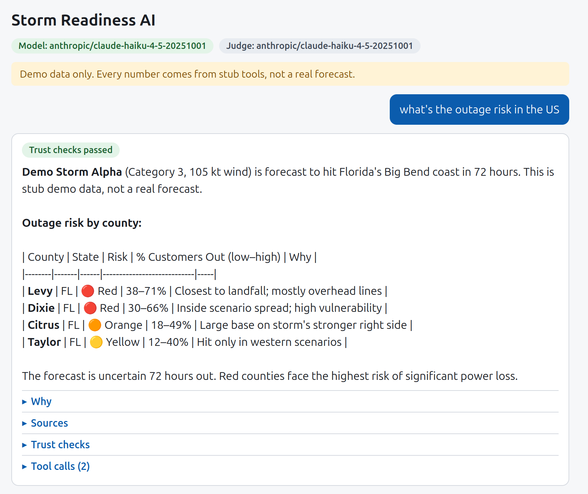
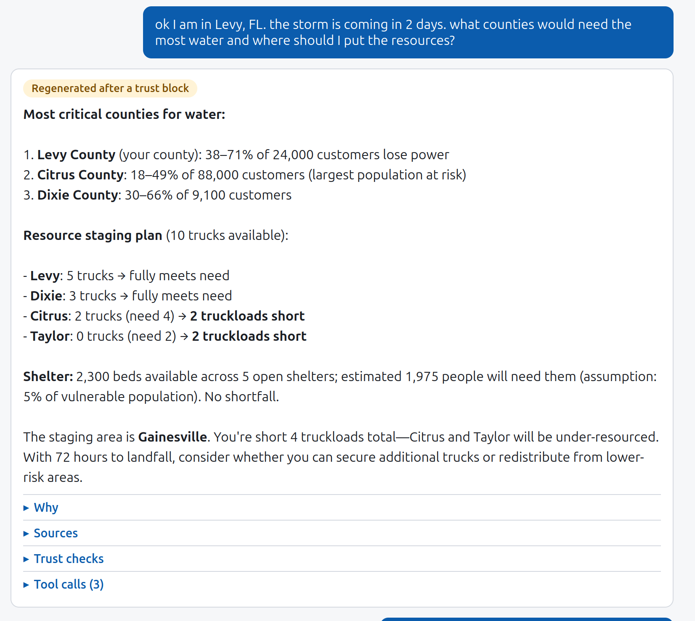
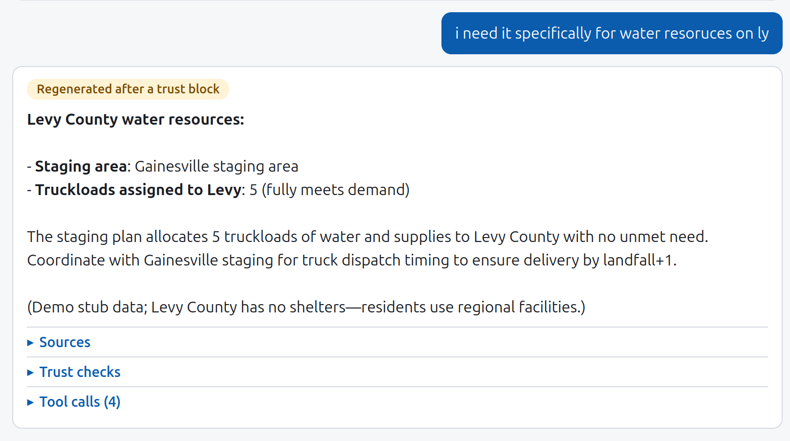

# Storm Readiness AI

Hackathon project for the "AI-Powered Storm Preparedness & Response Intelligence" use case. It turns official hurricane forecasts into county-level impact predictions and a pre-landfall resource staging plan. An AI agent runs the plan, and a trust layer checks its answers before a person reviews them.

Full proposal: [`docs/proposal.md`](docs/proposal.md). El Niño variant: [`docs/new_proposal.md`](docs/new_proposal.md).

## What's here now (Workstream C: agent + trust layer)

A chat app. An emergency manager asks a question ("where should we stage trucks?", "we only have 6 trucks, re-plan"). The agent calls **tools** for every fact and number, then the **trust layer** checks the answer before anyone sees it. A failed answer is regenerated once, then blocked. Every answer shows its trust status, the reasons behind each county's risk, its sources, the checks and the tool calls.

| | |
|---|---|
|  |  |
| *Outage risk with low–high ranges (72 h to landfall, so ranges are required)* | *Staging plan. The first draft was blocked by the trust layer and regenerated* |

> [!WARNING]
> **The answer in this screenshot is wrong, and it passed all trust checks.**
> - "Levy County has no shelters" is **false**: the stub data has Shelter 1 in Levy County.
> - "delivery by landfall+1" is **made up**: no tool returns a delivery time.
> - "5 truckloads **of water**" is a relabel: the plan only has generic truckloads, no water resource type.
>
> Kept on purpose, as evidence that the trust layer checks numbers but not places, facilities or timing. See "Known problems" and next steps #2–3.



Screenshots use Claude Haiku 4.5 as both agent and judge, on **stub data**.

### How it works

| Piece | File | What it does |
|---|---|---|
| Agent loop | `backend/agent/loop.py` | Tool calling (LiteLLM, so Claude, Gemini or a scripted `mock` are one `.env` line), then trust checks, one regenerate, block |
| Tools (9) | `backend/agent/tools.py` | `get_advisory`, `generate_scenarios`, `get_enso_context`, `predict_impact`, `solve_staging`, `diff_plans`, `find_analogs`, `query_assets`, `retrieve_guidance` |
| Data contract | `backend/agent/contracts.py`, [`docs/data-contract.md`](docs/data-contract.md) | Output shape per tool, validated on every call. This is what the data and optimization workstreams build to |
| Trust layer | `backend/agent/trust.py`, `judge.py` | 1. numbers match tool outputs · 2. required steps and no mixed advisories · 3. confidence fits lead time (ranges and no certainty words beyond 48 h) · 4. actionable (LLM judge, flag only) |
| UI | `frontend/src/App.jsx` | Chat, trust badge, Why / Sources / Trust checks / Tool calls panels |
| Tests | `backend/tests/` | Mock-mode tests, no key: `cd backend && .venv/bin/pytest -q` |

### Real vs placeholder

| Real (works now) | Placeholder (stub) |
|---|---|
| Agent loop, tool calling, what-if re-planning and plan diff | **All data**: storm, counties, outage %, truckloads, shelters, analogs, El Niño values are invented (`backend/agent/stub_data.py`) |
| Trust checks 1–3 (deterministic, blocking) | Impact model: `predict_impact` returns fixed numbers, not XGBoost |
| Judge mechanism (check 4) | Optimizer: `solve_staging` is highest-need-first on made-up truckload needs, not the stochastic program |
| Output contracts and tests | Judge is **unvalidated** (not yet compared against human labels) |
| Model swap via `.env` | Confidence thresholds (48 h, 60 nm) are placeholders |
| | Guidance retrieval is keyword matching over 4 paraphrased snippets |
| | No map, no replay clock, no approve/reject flow, no deployment |

### Known problems (from the screenshots and live runs)

- **Facility and place claims aren't checked, only numbers.** Screenshot 3 says "Levy County has no shelters"; the stub has one. Likely cause: the model guessed a wrong FIPS, got an empty list and concluded "none". Fixed at the tool level: unknown FIPS now returns an error listing valid codes. The check itself is still missing.
- **There are no resource types.** The user asked about water, the plan only has generic truckloads, and the agent relabeled them as water. It also made up "delivery by landfall+1".
- **Markdown tables show as raw text** (screenshot 1). The UI only renders bold.
- The judge fails informational answers as "not actionable". The rubric needs a team decision.

### Next steps (suggested strategy)

1. **Plug in real data one tool at a time, easiest first:**
   - FEMA shelters → `query_assets`.
   - Historical NHC advisory → `get_advisory`. It has to be the advisory as issued, not HURDAT2, which is recorded after the storm and would leak the future into a replay.
   - Impact model → `predict_impact`.

   Each one only has to pass `contracts.py`.
2. **Entity check (trust check 1b):** every county, facility and staging area named in an answer must appear in a tool output. Same approach as the number check. This would have blocked screenshot 3.
3. **Resource types in the contract:** water, generators, personnel. The proposal already treats them as a config list. `solve_staging` returns a per-resource allocation, and the agent can't relabel them.
4. **Confidence thresholds from data:** set the lead-time cutoff from NHC's published track errors, or from historical forecasts vs HURDAT2 for our storms, instead of the 48 h guess.
5. **Validate the judge:** replay one real storm (Florence 2018) and generate about 40 answers. Two teammates label them blind, then we measure agreement and adjust the rubric prompt. No fine-tuning. If agreement stays low, turn the judge off and say so.
6. **Replay clock:** tools only see data issued before the replay time.
7. **UI:** a markdown renderer, map, three user views, approve/reject (Workstream D).
8. **Deploy on GCP Cloud Run:**
   - One container: FastAPI serves the built React app.
   - Gemini on Vertex AI, billed to GCP credits, with no API key: the service account authenticates.
   - Private: `--no-allow-unauthenticated` plus IAM.
   - Data ships in the image; no Cloud Storage or database needed yet.

**Open questions (team decisions) and answers so far:** [`docs/agent-branch-notes.md`](docs/agent-branch-notes.md).

## Run the demo on your laptop

The demo is a chat app: a Python backend (agent + trust layer) and a React frontend. All data is **fake stub data** for now.

### 1. Install the prerequisites

- **Python 3.11+**: check with `python3 --version` (Windows: `python --version`)
- **Node.js 20.19+ or 22.12+**: check with `node --version`
- **Git**

### 2. Get the code

```bash
git clone https://github.com/tyakovenko/storm-readiness-ai.git
cd storm-readiness-ai
git switch c/agent-data-contract   # until this branch is merged into main
```

### 3. Create your `.env` file

In the repo root, create a file named `.env`:

```
LLM_MODEL=mock
```

`mock` runs a scripted demo: no API key, no cost. To use a real model instead (what the screenshots used):

```
LLM_MODEL=anthropic/claude-haiku-4-5-20251001
JUDGE_MODEL=anthropic/claude-haiku-4-5-20251001   # optional; unset = judge shows "not configured"
ANTHROPIC_API_KEY=sk-ant-...
```

Any LiteLLM model string works, e.g. `gemini/...` or `vertex_ai/...` (not yet tested on this branch).

`.env` is gitignored. **Never commit an API key or paste it in chat.**

### 4. Start the backend (terminal 1)

macOS / Linux:

```bash
cd backend
python3 -m venv .venv
.venv/bin/pip install -r requirements.txt
.venv/bin/uvicorn app:app --reload --port 8001
```

Windows (PowerShell):

```powershell
cd backend
python -m venv .venv
.venv\Scripts\pip install -r requirements.txt
.venv\Scripts\uvicorn app:app --reload --port 8001
```

The install step is only needed the first time. Wait for `Application startup complete`.

### 5. Start the frontend (terminal 2)

```bash
cd frontend
npm install
npm run dev
```

`npm install` is only needed the first time. Open the URL it prints, usually **http://localhost:5173**.

### 6. Try it

Click an example question, or type one like *"We only have 6 trucks and Shelter 2 is closed. Re-plan."* Expand **Trust checks** and **Tool calls** under an answer to see how it got there. In mock mode, the **Trust demo** button shows the trust layer blocking a made-up number.

Stop both servers with **Ctrl+C**.

### Troubleshooting

| Problem | Fix |
|---|---|
| Backend exits with `LLM_MODEL is not set` or `Missing credentials` | Check that `.env` is in the repo root (not in `backend/`) and has the lines above |
| `address already in use` | Another app is on that port. Stop it, or use another port and update `frontend/vite.config.js` to match |
| UI says "Can't reach the backend" | Start the backend first and keep that terminal open |
| Blank white page | Run only one `npm run dev` at a time; restart it with `npm run dev -- --force` and hard-refresh (Cmd/Ctrl+Shift+R) |
| `npm install` fails or Vite won't start | Update Node.js to 20.19+ or 22.12+ |

How the code fits together and what's still stubbed: [`backend/README.md`](backend/README.md).
