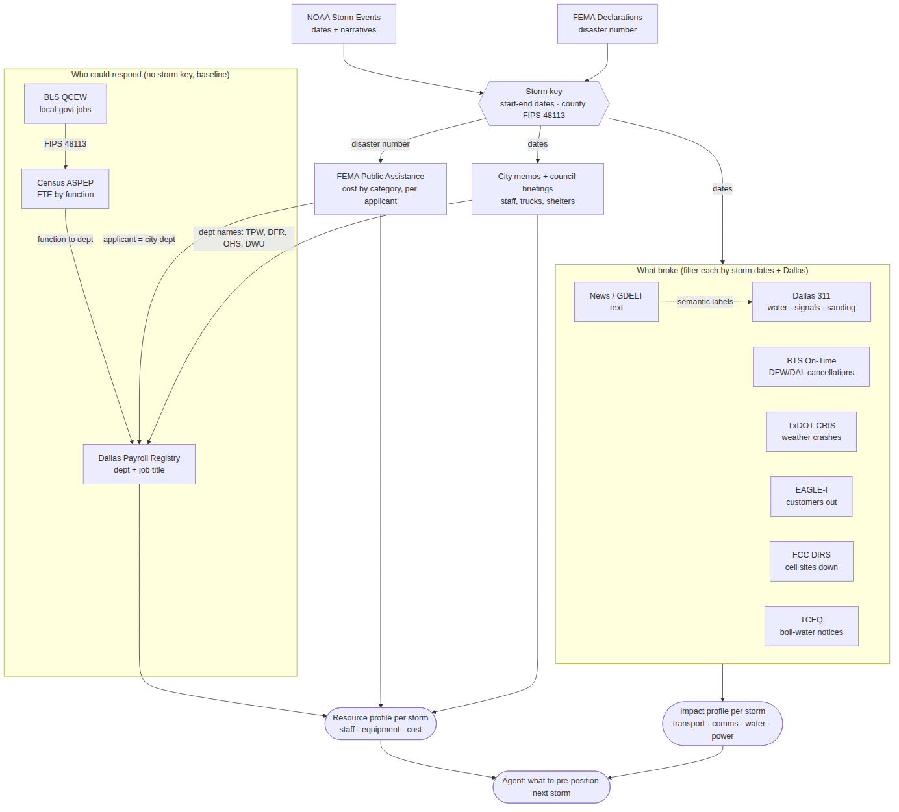

# Dallas County Storm Data Sources

Data sources for a county-level storm-readiness agent, focused on **Dallas County, TX (FIPS 48113)**. This doc lists sources only. The counts are there to show each source really has Dallas coverage; they are not the data itself. Checked 2026-10-02.

## Why Dallas, and which storms

- **Hurricanes don't hit Dallas directly. They reach it in two ways:**
  1. **Evacuee sheltering.** Dallas County appears on 9 FEMA hurricane or tropical-storm declarations: Tropical Storm Charley 1998, Katrina 2005, Rita 2005 (×2), Dean 2007, Gustav 2008, Ike 2008, Harvey 2017, Marco/Laura 2020. Most are emergency (EM) declarations for sheltering evacuees, not local damage. Katrina brought about 26,000 evacuees to North Texas shelters; Harvey had 3,500+ people at the Dallas convention center.
  2. **Remnant rainfall and flooding.** NOAA records 5 Dallas events tied to Tropical Storm Hermine (2010), 2 to Lorena's remnants (2025), and 13 flood events in August 2022 driven by tropical moisture (about 1.35B in recorded property damage).
- **Winter storms do direct damage:** Uri 2021, the 2023 ice storm, January 2025, January 2026. NOAA has 80 winter-type events for Dallas from 2000 to 2026.
- **Outlook:** a strong El Niño is expected for winter 2026–27, which makes a wetter North Texas likely. Ice also needs arctic air at the same time, so this raises the odds; it is not a forecast.

## How the sources connect

**The join key is the storm window.** NOAA event dates plus the FEMA disaster number define each storm. Every impact source is then filtered by those dates and by Dallas (FIPS 48113, city limits, or the DFW and Love Field airports). The staffing sources don't have a storm key. They describe the baseline workforce, and they link to storm-time resource use through department names: TPW = Transportation & Public Works, DFR = Dallas Fire-Rescue, OHS = Office of Homeless Solutions, DWU = Dallas Water Utilities. Those names appear in the city memos, FEMA applicants, and 311 request types.

## 1. Storm identification

| Source | What it has | Access | Dallas coverage (checked) |
|---|---|---|---|
| **NOAA Storm Events Database** | Each event's type, start and end, deaths, injuries, damage, and **free-text episode and event narratives** | Bulk CSV: `ncei.noaa.gov/pub/data/swdi/stormevents/csvfiles/`, filter `STATE=TEXAS`, `CZ_NAME=DALLAS` | 1,410 events (2000 to Jun 2026); 1,368 with narratives |
| **OpenFEMA Disaster Declarations Summaries** | Disaster number, incident type, which programs were declared (PA, IA) for each county | API: `fema.gov/api/open/v2/DisasterDeclarationsSummaries`, filter `fipsStateCode='48'`, `fipsCountyCode='113'` | 28 declarations (1966–2024), 9 of them hurricane or tropical storm |

## 2. Workforce: who could respond (baseline)

| Source | What it has | Access | Notes |
|---|---|---|---|
| **City of Dallas Payroll Registry** | City-wide **totals** every two weeks: civilian vs uniformed employee count and pay. No department or job title | Dallas OpenData `qrgv-mijx` (Socrata API) | 134 rows, last updated 2019. Only useful as a headcount baseline (e.g. about 7,800 civilian, 5,100 uniformed in Oct 2019) |
| **City of Dallas Operating Budget** | Budget by appropriation, service, and object group (personnel, supplies, capital) | Dallas OpenData `e2fs-y4nb` | 1,498 rows, FY2026. Personnel **spending** by service, not headcount. Headcount by department is only in the annual budget book (PDF) |
| **Census Annual Survey of Public Employment & Payroll (ASPEP)**, individual-unit file | Full-time-equivalent staff and payroll by **function** (police, fire, highways, water, hospitals, corrections) for each government | census.gov ASPEP downloads | Covers Dallas County, the cities in it, and special districts. Only source that gives function for every local government |
| **BLS QCEW** | Local-government employment and wages by county and industry, quarterly | bls.gov/cew | County totals; not checked this session |

## 3. Resources used in past storms

| Source | What it has | Access | Dallas coverage (checked) |
|---|---|---|---|
| **City memo "January 2025 Winter Storm by the Numbers"** | Staff by department, trucks, lane-miles sanded, shelters and occupancy, calls by type | dallascityhall.com, City Manager memos FY24-25 | 175 TPW staff on two 12-hour shifts, 50 trucks, 4,000 lane-miles; 200+ field staff, 27 in the EOC, 180+ remote; 4 shelters averaging about 950 people a day |
| **Office of Emergency Management "Winter Weather Operations" council briefing (2025-11-05)** | Shelter history 2019–2025, cost per activation, departments involved, comparison with Houston, Austin, Fort Worth, San Antonio | cityofdallas.legistar.com | Peak 1,314 guests; 4,167 stays in January 2025; FY24 cost 2.9M against 0.9M budgeted |
| **Dallas City Council Legistar archive** | Every briefing and after-action presentation, searchable by date | cityofdallas.legistar.com | Main source for Uri, 2023, and 2026 staffing (needs a scraper) |
| **Garland after-action (January 2026)** | Calls, sand, staff hours for a city inside Dallas County | Garland council video and agenda | 2,915 police calls, 591 fire calls, 200 t sand |
| **OpenFEMA Public Assistance Funded Projects Details** | Each funded project's applicant, damage category (A debris … G recreation; B = emergency protective measures), and amount | API: `fema.gov/api/open/v2/PublicAssistanceFundedProjectsDetails`, filter `countyCode='113'` | 516 projects. Katrina (EM-3216): 82 projects, about 51.8M, almost all sheltering and interim housing. Uri (DR-4586): 33 projects, about 4.2M |
| **City of Dallas recovery-grant (CDBG-DR) plan, Winter Storm Uri** | Unmet needs and allocation after Uri | dallascityhall.com, CDBG-DR page | 40M+ allocated |

**FEMA caveat:** the PA `county` field is the **applicant's** county, not where the damage was. The Ike and Harvey records under Dallas are mostly a hospital system headquartered in Dallas County repairing hospitals on the coast. Filter by applicant before treating these as local.

## 4. Impacts: what broke, by sector

| Sector | Source | What it has | Access | Dallas coverage (checked) |
|---|---|---|---|---|
| **Cross-sector** | **Dallas 311 Service Requests (2000 to present)** | Request type, department, created and closed time, location | Dallas OpenData `4n3h-rfqm` (Socrata API, updated hourly) | 5.36M requests in total. Storm windows: Uri 3,527; Feb 2023 ice 4,501; Jan 2025 2,356; Jan 2026 3,800. Weather-specific types include "Snow/Ice Sanding – Hazardous", "Traffic Signal – Flashing", "Water/Wastewater", "Inclement Weather Shelter Transportation" |
| **Transportation (air)** | **BTS Reporting Carrier On-Time Performance** | Every flight's cancellation flag and cause code (B = weather), for DFW and DAL | transtats.bts.gov, monthly zip | Not pulled. News: about 75% of DFW flights cancelled in Feb 2023; about 1,500 at DFW and Love Field in Jan 2026 |
| **Transportation (roads)** | **TxDOT CRIS crash records** | Crashes by county with weather and surface condition (ice) | cris.dot.state.tx.us public query | Not pulled |
| **Power** | **EAGLE-I (ORNL)** | Customers without power by county, every 15 minutes, 2014–2025 | figshare doi 10.6084/m9.figshare.24237376; OSTI | Already in the project's data contract |
| **Communications** | **FCC DIRS reports** | Cell sites out of service by county; status of 911 centers, cable, and wireline during an activation | fcc.gov DIRS daily reports (PDF/TXT) | Activated for Harvey 2017 and Winter Storm Fern (Jan 2026); not confirmed for Uri |
| **Water** | **TCEQ boil-water notices / Drinking Water Watch** | Notices by water system and date | tceq.texas.gov | Not pulled; 311 water types work as a proxy |
| **Narrative (for the news analysis)** | **NOAA narratives + local news + GDELT** | Free text: what failed and why | NOAA bulk CSV; GDELT API; KERA, Dallas Morning News, WFAA | Start with the NOAA narratives (1,368 Dallas texts, already geocoded) |

## 5. Hurricane evacuee sheltering (Dallas as a host city)

For Dallas the hurricane risk is **receiving** coastal evacuees, not evacuating its own residents. The questions are: how many arrive, where they stay, and which local staff and facilities get used.

| Question | Source | What it has | Access | Dallas coverage |
|---|---|---|---|---|
| Sheltering cost per storm | **OpenFEMA Public Assistance, category B** (section 3) | Shelter and interim-housing projects per applicant | API, filter `countyCode='113'` | Katrina EM-3216: 82 projects, about 51.8M. Also Rita, Dean, Gustav, Ike, Harvey, Laura |
| Shelter capacity (baseline) | **National Shelter System Facilities** (FEMA and Red Cross) | Each shelter's location, capacity, ADA access, pets | data.gov `national-shelter-system-facilities`; mirrors at the Data Rescue Project and FEMA on ArcGIS (the government site HIFLD Open has been shut down) | All designated Dallas shelters |
| Shelters open now | **National Shelter System, open shelters** | Open shelters and occupancy | AmeriGEOSS / FEMA feed | Live only, no history |
| State hub plan | **Texas Mass Care annex (ESF-6), 2020** | How the shelter hub system, reception centers, and shelter types work | Texas Division of Emergency Management (TDEM) website, PDF | Doesn't list hub cities or capacity; needs a request to TDEM |
| Load on hospitals | **CDC: medical surge in DFW during Harvey** | Emergency-department visits at 55 DFW hospitals (North Texas syndromic surveillance); evacuees' home counties | stacks.cdc.gov/view/cdc/86104 | About 16,500 excess visits; visits from patients in disaster-declared counties +127% |
| Shelter operations | **Harvey mass sheltering in Dallas County** (PMC6255530) | Disease surveillance at the Dallas mega-shelter | PMC | 3,500+ registered guests |
| Shelter shortfall method | **Harvey shelter deficits for socially vulnerable Texans** (PMC6537281) | Shelter shortfall by county and population group | PMC | Method we could reuse |
| City staffing and cost | **Dallas council archive (Legistar) + 311** | Mega-shelter briefings; 311 requests for the storm window | Legistar; Dallas OpenData `4n3h-rfqm` | Harvey window: 16,877 requests in 311, mostly routine types, so filter for shelter-related ones |
| Where evacuees go | **Texas Hurricane Evacuation Studies** (USACE, FEMA, Texas A&M Coastal Bend) | Behavioral surveys: share evacuating inland, destinations | texasatlas.arch.tamu.edu | No public DFW-specific share found |
| Where evacuees go | **Smartphone location data to predict evacuee destinations** (Springer, 2023) | Machine-learning method | Paper | Underlying data usually not public |
| Where evacuees ended up | **Katrina displacement counts** (Census and surveys) | Where evacuees ended up | Census | North Texas about 26,000 in shelters |

**Gap:** no public dataset counts daily evacuee arrivals in Dallas. Best proxy: ER visits from disaster-declared counties + FEMA category B cost + peak shelter counts from council briefings.

## Gaps

1. **Staff deployed per storm** only exists as numbers for January 2025. Other storms need the Legistar briefings scraped and pulled into a table by hand.
2. **No per-employee roster is open data**, for the city or the county. Headcount by department means the budget book PDF, or ASPEP at the function level.
3. **The news analysis has a small sample:** about 4–5 major storms. Use the structured counts (311, BTS, EAGLE-I, DIRS) to measure impact, and the text to explain why.
4. **Hurricane relevance:** for Dallas the hurricane problem is mostly *sheltering evacuees* (section 5), not wind or surge damage. Pick the agent's framing before choosing which sources matter most.
