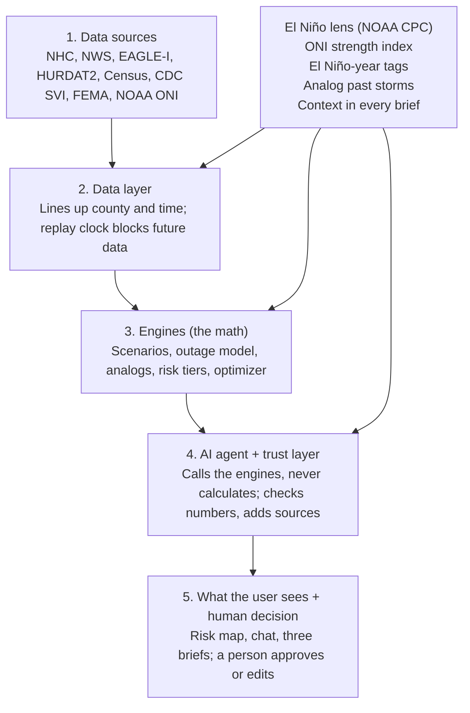

# Storm Readiness AI: El Niño Hurricane Proposal

Sep 25, 2026 · @Kanupriya

## The idea

We turn an official hurricane forecast into county-level impacts and actions, and we read every storm through an El Niño lens: what happened when similar storms struck in past El Niño years. We don't forecast the weather; NOAA's National Hurricane Center (NHC) does that. We predict its consequences: which counties lose power, which shelters fill, where to stage generators, and what to tell residents.

**One line for the team:** data in, engines do the math, the agent explains it, a person decides.

**What El Niño really does to hurricanes.** El Niño doesn't create hurricanes; it shifts where and how often they form:

- **Atlantic and Gulf: usually fewer storms.** El Niño strengthens the upper-level winds that tear storms apart over the Caribbean. The strong El Niño seasons of 1997 and 2015 were quiet.
- **But fewer doesn't mean safe.** In 2023 a strong El Niño met record-warm Atlantic water, and the season was above normal. Hurricane Idalia hit Florida's Big Bend as a Category 3.
- **Eastern Pacific: usually more and stronger storms.** In 2015 Patricia became the strongest hurricane on record in the Western Hemisphere. In 2023 Hilary brought Southern California its first-ever tropical storm warning.

**Our angle.** In a super El Niño year, the question isn't just "is a storm coming?" but "how does this year differ from a normal one, and what did storms like this do before?" We answer it three ways: El Niño strength becomes a model input, the system finds matching past storms (analogs), and every brief explains the El Niño context in plain words.

**Scope:** US hurricanes in the Atlantic, the Gulf and the Eastern Pacific (California, Hawaii), 2014 to 2024. That is where free forecast, outage and history data all line up. Other storm types, flooding and roads are future work, and we say so openly.

## Architecture

The system has five layers, read top to bottom. The El Niño lens is the new piece: it tags data, feeds the engines and shapes what the agent says.

1. **Data sources.** Free, public feeds: the storm (NHC, NWS), what past storms did (EAGLE-I outages, HURDAT2 tracks), who lives where and how vulnerable they are (Census, CDC SVI, FEMA NRI), what facilities exist (HIFLD, FEMA depots), and El Niño strength (NOAA's Oceanic Niño Index, ONI).
2. **Data layer.** Lines everything up by county and time. A replay clock makes sure the system only sees data known at a given moment.
3. **Engines.** Build possible tracks, predict power outages per county, find matching past storms, score risk from green to red, and decide where to stage supplies.
4. **AI agent + trust layer.** The only part users talk to. It never calculates; it calls the engines, and the trust layer checks every number and attaches sources.
5. **What the user sees.** Risk map, chat, separate briefs for organizations, responders and residents, and a person who approves or edits before anything happens.

## Models and methodology

We build one predictive model and wrap it with simple, explainable methods. Each stage follows the sponsor's Big Idea flow, and all data is free and public.

| Stage | What it does | Method | Data |
| --- | --- | --- | --- |
| Storm detection | Finds active storms and alerts | Automatic feed pull | NHC active storms, NWS alerts API |
| Forecast | Official track, cone and arrival time of tropical-storm winds | NHC product used as is | NHC advisories + GIS files |
| El Niño context | How strong El Niño is now; which past storms look like this one | ONI lookup + analog search | NOAA CPC ONI, HURDAT2 |
| Impact prediction | Peak % of customers without power per county: low, median, high | XGBoost (quantile) | Labels: EAGLE-I. Inputs: wind, distance to track, population, FEMA NRI, ONI |
| Risk assessment | Four tiers, green to red, drill down region → county → tract → facility | Rule-based score | Outage prediction, CDC SVI, FEMA flood zones |
| Critical assets | Flags hospitals, shelters, fire and police stations in high-risk areas | Map overlay | HIFLD, OpenStreetMap |
| Resources | Shelter beds, water, generators needed | People affected × standard rates | Census + outage prediction |
| Actions | Where to stage supplies and crews; three separate briefs | Small optimization, or highest need first | FEMA depots, FEMA / Ready.gov guidance |
| Human decision | Review, edit or approve the plan | Person in the loop | None |

**The models in plain words:**

- **Outage model (XGBoost).** Learns from past storms how wind, distance to the track, population and vulnerability turn into outages. It gives a low, median and high estimate, so users see the uncertainty. El Niño strength is one of its inputs.
- **Analog finder.** Compares the incoming storm with every past storm on track, strength and El Niño phase, and returns the closest five. The agent says, for example, "storms like this one in El Niño years caused these outages." Tracks and strength come from HURDAT2 and ONI, both reaching back to 1950, so analogs go well beyond our outage years.
- **Risk score.** Adds exposure, predicted outage and social vulnerability into one number, then cuts it into four tiers. Every tier shows its breakdown, which answers "why is this area high risk?"
- **Scenario spread (upgrade).** Builds many possible tracks around the NHC forecast from NHC's own past errors, using a simple AR(1) model.
- **AI agent + trust layer.** An LLM that picks which engine to call and writes the briefs. It never invents numbers: each number is checked against a tool output, and a mismatch is blocked.

**Why El Niño is an input, not its own model.** Only a handful of US landfalls in 2014 to 2024 happened in El Niño years. That is too few to train a separate model, so we use El Niño as an input and as the lens for finding analogs. We state this limit openly.

## Evaluation: replay past storms

We prove it works by replaying real hurricanes and beating simple baselines. There is no paper to replicate.

**How a replay works:** set the clock to 3 days before landfall. The system sees only what was known then: that day's NHC forecast, El Niño strength, population and facilities. It predicts and plans. Then we unlock what really happened (HURDAT2 track, EAGLE-I outages) and grade it.

**Test storms** (held out from training; Florence 2018 is the development storm):

| Storm | El Niño condition | Why it tests us |
| --- | --- | --- |
| Idalia 2023, Florida | Strong El Niño | Dangerous Atlantic landfall in an El Niño year |
| Hilary 2023, California | Strong El Niño | Rare Pacific storm reaching the US mainland |
| Michael 2018, Florida | El Niño developing | Rapid strengthening to Category 5 |
| Ian 2022, Florida | La Niña (control) | Checks we still work outside El Niño years |

| Part | Metric | Must beat |
| --- | --- | --- |
| Outage model | Error on peak % out; recall of hardest-hit counties | "Wind above X" rule; same model without El Niño input |
| Analog finder | Do the analogs' outages bracket the real outcome? | Random past storms |
| Optimizer | Unmet demand and cost under real outages | No pre-staging; highest-need-first |
| AI agent | Mismatched-number rate, block rate, approval rate | Same agent without trust layer |
| Whole system | Walkthrough with test users against the sponsor's success criteria | None |

**Automatic checks at every layer:** complete, in-range data; low ≤ median ≤ high; the solver never ships more than it has; every agent number matches a tool output. **The most important check is no data leakage:** every query goes through the replay clock.

## MVP, build plan and decisions

The design covers every MVP requirement and follows the demo path: Select Storm → View Forecast → Analyze Impacts → Identify High-Risk Areas → Ask AI → Receive Recommendations.

| Sponsor requirement | Covered by |
| --- | --- |
| Storm data ingestion; trajectory / forecast | NHC + NWS feeds, replay of past storms, track and cone |
| Geographic visualization; high-risk locations | Four-tier risk map, drill down to facility |
| Risk / impact analysis; predictive capability | Outage model (XGBoost) + risk score |
| AI recommendations; natural-language interface | Optimizer + agent briefs in a chat panel |
| Why an area is high risk; data / sources shown | Risk breakdown, El Niño analogs, sources on every answer |

**Build simple first, then upgrade.** The must-have version guarantees a working demo: NHC forecast as is, one XGBoost outage model with the El Niño input, the analog finder, a rule-based risk score, highest-need-first allocation, and an LLM agent with a number check. Upgrades, in order of value: (1) scenario spread from NHC's past errors, (2) an optimizer that plans across all scenarios, (3) flood and road layers, (4) Google WeatherNext as an alternate forecast.

**Key decisions:**

- **Don't forecast the weather ourselves.** NHC does it better; our value is impacts and actions.
- **El Niño is a lens, not a promise.** It changes the odds for a season; it never overrides the forecast for a real storm.
- **The LLM never invents numbers.** Every number comes from a tool and is checked by the trust layer.
- **Data considered but not used:** paid weather APIs (they duplicate free NOAA data), social media (can't be verified), 911 calls and response times (not public). Google Maps / Waze traffic is a phase-two option.

**Open questions:**

- [ ] Confirm NOAA CPC's current El Niño outlook for the coming season before we call it a "super El Niño" year.
- [ ] Keep the Eastern Pacific (California, Hawaii) in scope, or stay Atlantic and Gulf only?
