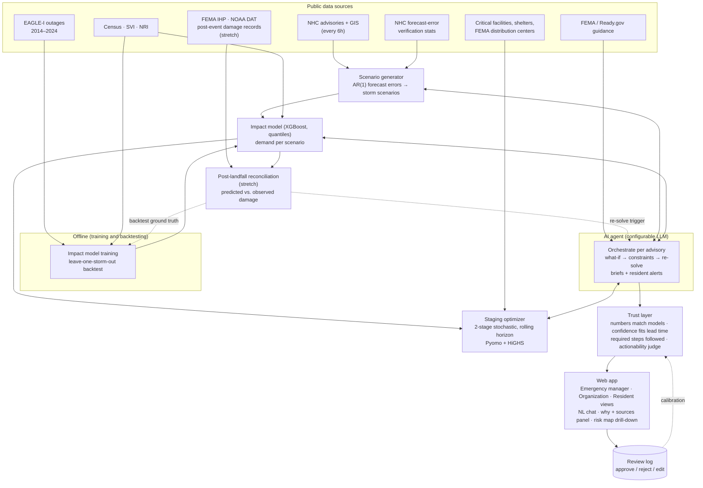

# Storm Readiness AI — Project Proposal

**Use case:** AI-Powered Storm Preparedness & Response Intelligence
**Status:** Draft for sponsor/mentor review · 2026-09-24
**Team workstreams:** A — Data & impact model · B — Scenarios & staging optimization · C — Agent & trust layer · D — App, accessibility & demo *(owners to be assigned)*

---

## 1. Summary

When a hurricane is 3–5 days out, forecasters tell us where the storm is likely to go. They don't tell a county emergency manager how many households in their county will lose power, which shelters will fill up, or where to put generators and water *before* the roads close.

We propose a decision-support system that turns an official hurricane forecast into a **staged resource plan**, and updates it every time a new forecast comes out:

1. **Forecast scenarios.** Generate plausible storm tracks and intensities from the current National Hurricane Center (NHC) advisory, using NHC's own historical forecast errors.
2. **Impact prediction.** Predict county/tract-level impacts (power outages, shelter demand) with a model trained on 10 years of real outage data.
3. **Staging optimization.** Choose where to pre-position supplies and equipment across all scenarios, using a published stochastic optimization method for hurricane relief logistics. We extend it with an outage-driven resource layer.
4. **AI agent.** An agent runs this loop on every new advisory, answers "what if" questions from the emergency manager by re-solving the plan, and writes the operations brief and plain-language resident alerts.
5. **Trust layer.** Every AI output is checked before a human sees it: numbers must match the models, confidence must match forecast uncertainty, the agent must have followed the required steps, and the output must be actionable.
6. **Human review.** A person approves, rejects or edits each recommendation, and every decision is logged.

The AI agent does real work in the loop: it runs the pipeline, turns requests into optimizer constraints and re-plans. The quantities in any recommendation come only from models that can be tested against past storms, never from the language model's own guesses.

---

## 2. Problem and users

**Challenge statement:** *Predict impending storm impacts, identify areas and assets at risk, and provide timely, actionable recommendations that enable organizations, emergency responders, and residents to prepare and stage resources before the storm arrives.*

| Challenge requirement | Where it is addressed |
|---|---|
| Predict impending storm impacts | Impact model (§4.2) run over forecast scenarios (§4.1) |
| Identify areas and assets at risk | Risk map by county/tract + overlay of critical facilities (hospitals, shelters, fire/EMS, water) |
| Timely recommendations | Plan regenerated automatically on every NHC advisory (every 6 hours) |
| Actionable, before the storm arrives | Optimized staging plan (what, how much, where, by when), checked by the trust layer |
| Organizations, emergency responders, residents | Three views of the same plan (below) |

**Users:**
- **Primary: county/regional emergency managers.** They own staging decisions and get the full plan, scenario spread, what-if queries, and approve/reject.
- **Organizations** (food banks, school districts, utilities' community partners). They get the resource needs relevant to them and a list of their facilities at risk.
- **Residents.** Plain-language, location-specific preparation alerts generated from the approved plan, including in Spanish.

**Why it matters:** staging decisions are made under forecast uncertainty. Over-staging wastes scarce inventory; under-staging leaves people without water, power or shelter capacity. Large organizations run 24/7 operations centers that connect forecasts to logistics. Most counties and community organizations don't have that capacity.

### 2.1 MVP compliance

The sponsor brief lists ten required MVP components and a specific demo flow. Every one is addressed in the MVP build below — none are pushed to the stretch or phase-2 items in §4.6 / §11.

| Required (MVP) | Where it is addressed |
|---|---|
| Storm data ingestion | §4.1 — live NHC advisory ingestion, every 6 hours |
| Geographic visualization | §7 — React + MapLibre map, four-tier risk drill-down (region → county → tract → facility) |
| Storm trajectory/forecast | §4.1 — NHC track/intensity forecast plus generated scenarios |
| Risk/impact analysis | §4.2 — impact model; risk map |
| At least one predictive capability | §4.2 — trained impact model (XGBoost), backtested against baselines (§10) |
| Identification of high-risk locations | Risk map + ranked county/facility list, from §4.2 output |
| AI-generated preparedness recommendations | §4.3 (staging plan) + §4.4 (agent-written operations brief and resident alerts) |
| **Natural-language interface** | §4.4 — a chat interface in the web app, backed by the agent's tool-calling loop, not just internal orchestration |
| **Explanation of why an area was identified as high risk** | §4.5 — every displayed recommendation carries the impact model's feature importance in plain language ("why") |
| **Display of underlying data/sources** | §4.5 — every displayed recommendation carries a sources panel naming the data and model outputs behind it, drawn from the trust layer's own groundedness check |

**Demo flow** (*Select Storm → View Forecast → Analyze Impacts → Identify High-Risk Areas → Ask AI → Receive Recommendations*): matches our replay mode directly — pick a historical storm, the pipeline runs through §4.1–§4.4, the risk map and brief populate, and the chat interface is available at every step for follow-up questions.

Our architecture (§4, §6) also mirrors the sponsor's own suggested design — *Storm Detection → Forecast → Impact Prediction → Risk Assessment → Resource Analysis → Recommended Actions → Human Decision* — stage for stage.

---

## 3. Existing work and positioning

| Area | Existing work | What we take from it | Gap we address |
|---|---|---|---|
| Weather/hurricane forecasting | NHC advisories and GIS products; Google DeepMind WeatherNext (AI cyclone forecasting, open weights) | We **consume** forecasts. We don't build a forecast model. | Forecasts stop at the weather. They don't say what it means for a given county's resources. |
| Post-event damage assessment | Google SKAI (building damage from aerial imagery, run operationally on Ian and Helene); FEMA/NOAA structured post-event damage records | Structured post-event damage data as a second, independent signal (§4.6) | We don't rebuild imagery-based damage detection (SKAI already does this well, and imagery availability isn't ours to control). We consume existing structured records instead, for a check that outage data alone can't do. |
| Commercial storm-impact platforms | Urbint Storm Impact (utility crew staging), Tomorrow.io, Esri GeoAI | Confirms the forecast → staging loop is valuable | Closed and enterprise-priced. No open, testable method for small agencies. |
| Outage prediction research | ORNL EAGLE-I + NWS models (random forest, XGBoost); county-level outage datasets | Training data and model family | Research models, not wired into staging decisions. |
| Relief pre-positioning research | Two-stage and multi-stage stochastic programs for hurricane relief logistics (e.g. Bhattarai & Song; Siddig & Song; Rawls & Turnquist) | **Our staging method** (§5) | Research code on fixed case studies: no live data, no learned demand, no operational interface. |
| LLM emergency guidance | Retrieval-based emergency guidance agents (e.g. SafeMate); LLM-generated warning guidelines | Retrieval over official guidance | Advice isn't tied to quantified impacts, and the LLM's claims aren't checked. |
| Hackathon prior art (Devpost) | Shelter maps, preparedness chatbots, checklist generators, relief demand forecasting | n/a | Almost none are tested against real storms or account for forecast uncertainty. |

**Our position:** this is an operational version of a published relief-logistics method. We extend it with an impact model tested on real outage data, and add an agent layer that is checked before its advice reaches people.

---

## 4. Approach and rationale

The central design rule: **each job goes to the tool that is actually good at it.** Physics and statistical forecasts handle the hazard. A trained, testable model handles impacts. Optimization handles allocation. The language model orchestrates, explains and communicates. The one failure we can't accept is a language model inventing quantities in a life-safety setting, and this design rules it out rather than trying to catch it afterwards.

### 4.1 Hazard scenarios
- **Input:** the current NHC advisory (track and intensity forecast, wind-speed probabilities, storm-surge maps).
- **Method (from Bhattarai & Song):** fit time-series (AR(1)) models to NHC's published historical forecast errors for track and intensity. Add sampled errors to the current forecast to generate storm scenarios. Group those scenarios into a small set of discrete storm states with probabilities of moving between them.
- **Why:** NHC's error statistics cover the whole Atlantic basin, so the method works anywhere on the US coast without new data. It also gives honest, forecast-grounded uncertainty without running weather ensembles ourselves.

### 4.2 Impact model
- **Target:** peak share of customers without power per county within the storm window (EAGLE-I, 2014–2024).
- **Features:**
  - hazard at the county: wind-field and rainfall features for each scenario
  - exposure: population, housing, customers served
  - vulnerability: CDC Social Vulnerability Index, FEMA National Risk Index components
  - geography: coastal distance, land cover/tree canopy
- **Model:** gradient-boosted trees (XGBoost) with quantile outputs, which give a low/median/high estimate per county.
- **Why this model:** it has strong published results on this exact task, trains in minutes on a CPU, and is easy to interpret (feature importance lets us explain *why* a county is flagged). It also has a clear baseline to beat.
- **Use:** run once per storm scenario to produce demand for the optimizer: generator needs at critical facilities, water/ice distribution points, cooling/charging centers.

### 4.3 Staging optimization
A two-stage stochastic program, re-solved in a rolling window on each advisory:
- **First stage (now):** where to pre-position each resource and how much.
- **Second stage (per scenario):** distribution after landfall, with penalties for unmet demand.
- **Risk-averse option:** optimize the worst-case tail of scenarios (CVaR), not just the average, for emergency managers who prefer to over-stage.
- **Resource types are a config list, not hard-coded to supplies:** generators, water/ice, shelter capacity, and also personnel and emergency vehicles (Idea C's "personnel staging," "emergency vehicle positioning"). Staging personnel/vehicles uses the same optimizer and the same demand signal — no new data source needed, just another entry in the resource-type list.

Details of what we reuse and extend are in §5.

### 4.4 Agent
A tool-calling agent orchestrates the pipeline and handles the interaction:
- **Tools:**
  - `get_advisory`, `generate_scenarios`, `predict_impact`
  - `solve_staging`, `diff_plans`, `query_assets`
  - `retrieve_guidance` (searches FEMA / Ready.gov guidance)
- **On each new advisory:** runs the pipeline, compares the new plan with the previous one, flags material changes ("Water demand in County X up 40% — track shifted west").
- **What-if requests:** turns them into solver constraints ("Shelter 4 is unavailable", "we only have 6 trucks"), re-solves and explains the difference.
- **Communication:** drafts the operations brief and resident alerts from the approved plan.
- **Model-agnostic:** the language model is a configuration setting (§7). Gemini, Claude or a self-hosted open-weights model (Gemma) can be swapped without code changes.
- **Natural-language interface (MVP required):** a chat panel in the web app, available to every user type. It's the same agent and the same tools as the automatic per-advisory run — a typed question ("What does County X need if the track shifts west?") becomes a tool call and a re-solve, not a separate, unverified free-text answer. This is what the "Ask AI → Receive Recommendations" step in the sponsor's demo flow refers to (§2.1).

### 4.5 Trust layer
Every agent output passes these checks before display:

| Check | Method | On failure |
|---|---|---|
| **Numbers match the models** | Deterministic: every quantity, place and facility in the text must match a field in a tool output | Blocked and regenerated |
| **Confidence fits lead time** | Rules: allowed certainty and spatial detail depend on forecast lead time and how much the scenarios disagree (e.g. no single-facility certainty 4 days out when the scenarios diverge) | Rewritten with the uncertainty stated |
| **Agent followed the required steps** | Checks the agent's sequence of tool calls: no plan without a current-advisory `solve_staging`, no stale-advisory data, no skipped steps | Blocked |
| **Actionable** | LLM-as-judge with a written rubric. **The judge is first tested against a human-labeled sample;** its scores are shown only if its agreement with the humans is acceptable | Flagged for the reviewer |

**What the user sees (MVP required, not just an internal check):** the trust layer's own groundedness check already traces every number in a recommendation back to a model output — that trail is surfaced, not just used internally. Each recommendation shown in the UI carries two things alongside it: a plain-language **"why"** (the impact model's feature importance for that location — e.g. "flagged for wind exposure and low canopy cover, not population alone") and a **sources** list naming the data and model runs it came from (which NHC advisory, which model version, which scenario set). This directly answers the *AI Quality* success criterion ("findings include supporting evidence").

### 4.6 Post-landfall reconciliation *(stretch — see §11 cut order)*
Outage data and structural damage are different failure modes, and they call for different resources. A house that's still standing but powerless needs a generator, water, a cooling center. A destroyed house needs search-and-rescue, shelter placement, debris clearance — outage-based staging never plans for that, because outage status alone can't distinguish the two. This step adds a second, independent ground truth so the system can catch that gap.

- **Input:** structured post-event damage records — FEMA Individual Assistance / Housing Assistance data (damage severity by county/ZIP/block group) and NOAA's Damage Assessment Toolkit (wind-damage survey polygons), both public and already structured. We deliberately don't build or run an imagery-based damage-detection pipeline: Google's SKAI already does this well, and it depends on aerial/satellite imagery being tasked and delivered, which isn't guaranteed on any schedule we control.
- **Live use, once damage data lands for an active storm:** diff it against the impact model's prediction and the current plan. A mismatch (damage where the model predicted low impact, or vice versa) is flagged for the trust layer, and can trigger a re-solve that shifts resource mix toward shelter/debris response in that area, via the same re-plan path as §4.4.
- **Offline use:** a second backtest ground truth (§10) — not just "did we predict the right outage numbers," but "did we predict where structural-damage response would be needed."
- **Why it's a stretch, not core:** it's a genuinely new data source and reconciliation path, and it can only ever run after landfall — it extends the **response** half of the challenge rather than the pre-landfall staging plan. The system is complete and defensible without it (§11).

### 4.7 Human review
Approve / reject / edit for each recommendation, with a reason code. The log is an audit trail, and later a calibration dataset for trust-layer thresholds. Human judgment stays the final control point.

---

## 5. Relationship to the published method

The staging layer builds on **Bhattarai & Song, *Multi-stage Stochastic Programming for Integrated Network Optimization in Hurricane Relief Logistics and Evacuation Planning* (Clemson University)**. Their case studies are Hurricane Florence (South Carolina) and Hurricane Ian (Florida).

| | Paper | This project |
|---|---|---|
| Scenario generation | AR(1) models of NHC forecast errors → Markov chain of storm states | **Reused** |
| Evacuation / shelter demand | Hand-set function of distance, intensity and time to landfall; 5% of the vulnerable population goes to public shelters | **Reused as-is and labeled as their assumption.** There is no public ground truth for shelter demand, so we don't claim to improve it. |
| Outage-driven resources | Not modeled | **New layer:** generators, water/ice distribution points, cooling centers, with demand from our trained impact model (§4.2) |
| Solution method | Fully adaptive multi-stage program (SDDP) vs. a rolling-horizon two-stage baseline | **Rolling-horizon two-stage program only**, which fits the hackathon timeline. The paper reports the adaptive policy performs better, and we state that as a known limitation. |
| Geography | One state per case; simplified straight coastline; hand-picked supply depot | National data sources (shelters, critical facilities, FEMA distribution centers, real coastline). Each run is regional, one storm. |
| Operational layer | None (research model) | Live advisory ingestion, agent, trust layer, review interface |

**Comparison we will report:** on held-out historical storms, the paper's shelter-only plan vs. our plan with the outage layer. Both are scored on unmet demand under the outages that actually happened (EAGLE-I).

**Credibility step:** we first reproduce the paper's Florence / South Carolina configuration. Then we generalize to a second storm (Ian or Helene).

---

## 6. Architecture



**Deployment (Google Cloud):**

```
Cloud Scheduler ──(every 6h)──► Cloud Run: API + agent (FastAPI) ──► Cloud Run: web app
                                   │           │
                                   │           └─► LLM: Vertex AI API (Gemini/Claude)   ← if permitted
                                   │               or Cloud Run GPU: vLLM + Gemma       ← open-weights path
                                   ├─► Cloud Storage: Parquet data, trained model files, scenario cache
                                   └─► Firestore: review log
Compute Engine VM (CPU): data pipeline, model training, backtests (started on demand)
Secret Manager: API keys · Cloud Logging: model/provider used per recommendation, errors, fallbacks
```

---

## 7. Technology stack

| Layer | Choice | Rationale |
|---|---|---|
| Language | Python 3.11+ | Geospatial, ML and optimization libraries |
| Data storage | Cloud Storage (Parquet) | The data is small once aggregated. No BigQuery needed. |
| Data processing | DuckDB, GeoPandas, xarray | Fast local SQL over Parquet; spatial joins; gridded forecast data |
| Impact model | XGBoost (quantile regression) | See §4.2. Small model file loaded in-process, so no dedicated model server. |
| Optimization | Pyomo + HiGHS (open-source solver) | Standard stochastic programming modeling; no commercial solver license |
| Agent framework | LiteLLM model interface + Google Agent Development Kit (ADK), or a plain tool-calling loop | One interface for Vertex Gemini, Vertex Claude and self-hosted models. Final choice on day 1 of the build. |
| LLM (configurable) | Gemini (Vertex AI) · Claude (Vertex AI Model Garden) · Gemma (open weights, self-hosted) | Not locked to one vendor. Answers the proprietary-model question either way. Allows side-by-side model comparison on trust-layer metrics. |
| Open-model hosting | vLLM on Cloud Run with GPU (1× NVIDIA L4), scales to zero | Pay only while in use. Compute Engine GPU VM as fallback. |
| Retrieval | Small embedded index over FEMA / Ready.gov guidance | The guidance corpus is small, so no managed vector database |
| Backend | FastAPI on Cloud Run | Simple, scales to zero |
| Frontend | React + MapLibre GL (open-source maps, no API key); WCAG AA contrast, keyboard navigation, screen-reader labels; four-tier risk map (🟢🟡🟠🔴) with region → county → tract → facility drill-down; chat panel wired to the agent (§4.4); per-recommendation why/sources panel (§4.5) | Usability and accessibility are scored; the drill-down and chat directly match the sponsor's Idea B and MVP requirements |
| Review log | Firestore | Serverless; no database to manage |
| Scheduling | Cloud Scheduler | Advisory polling |
| Observability | Cloud Logging | Every recommendation records which model and provider produced it. Fallbacks are logged as errors, never silent. |

**Startup validation:** at startup the service checks the configured LLM endpoint, credentials and tool-calling ability. It fails loudly instead of degrading on first use.

---

## 8. Data sources

All public. Access is to be confirmed before we depend on each one.

| Source | Use | Notes |
|---|---|---|
| NHC advisories and GIS products (track/cone, wind-speed probabilities, potential storm surge) | Live hazard input; historical replay | Live feeds plus archive |
| NHC forecast advisory archive | Historical forecasts for honest backtests (no hindsight) | Text advisories by storm |
| NHC forecast verification reports | Forecast-error statistics for the scenario generator | Atlantic basin, yearly |
| HURDAT2 best tracks | What the storm actually did, for training labels | Atlantic / NE Pacific |
| NWS alerts API (api.weather.gov) | Watches/warnings shown in the app | Live |
| EAGLE-I outage data (ORNL / DOE), 2014–2024 | Impact model labels | County level, every 15 min; coverage varies by utility and year, so we normalize by covered customers |
| US Census (decennial + ACS) | Population, households | County / tract |
| CDC/ATSDR Social Vulnerability Index | Vulnerability features; resident-alert prioritization | Tract / county |
| FEMA National Risk Index | Features; simple baseline model | County / tract |
| Critical facilities (HIFLD, OpenStreetMap / Overture) | Hospitals, shelters, fire/EMS, water facilities | Check current HIFLD availability; OSM/Overture as fallback |
| FEMA distribution center locations | Supply nodes for the optimizer | Public locations |
| OpenFEMA | Disaster declarations (context, selecting storms) | API |
| FEMA / Ready.gov preparedness guidance | Retrieval corpus for briefs and alerts | Public domain |
| *Stretch:* WeatherNext 2 (Cloud Storage, Zarr) | AI ensemble forecasts as an alternative scenario source | Access request required; requester-pays bucket |
| *Stretch:* FEMA OpenFEMA — Individuals and Households Program / Housing Assistance data | Post-landfall reconciliation (§4.6) and a second backtest ground truth (§10): damage severity by county/ZIP/block group | API, no PII, county/ZIP/block-group granularity (no street address) |
| *Stretch:* NOAA Damage Assessment Toolkit (DAT) | Post-landfall reconciliation and backtest: wind-damage survey polygons, EF-scale severity | CSV/GeoJSON/KMZ by date range; mainly built for tornado/convective wind, coverage for hurricane wind swaths to be confirmed |
| US Census TIGER/Line | City/county boundary geometries for the map | Public, free |
| USGS 3DEP elevation | Terrain context for flood modeling (§11 phase 2) | Public, free |
| *Phase 2 (§11):* FEMA National Flood Hazard Layer (NFHL) | Flood zones, for the multi-hazard impact layer | Public API/download |
| *Phase 2 (§11):* OpenStreetMap / Overture — roads, bridges, transit infrastructure | Road/bridge/transit risk overlay, for the multi-hazard impact layer | Same source already used for critical facilities above |
| *Phase 2 (§11):* HIFLD power infrastructure (substations, transmission) | Asset-level power-grid risk, beyond EAGLE-I's county aggregate | Availability to be confirmed, same caveat as HIFLD critical facilities above |
| *Stretch, map display only:* NOAA OGC WMS / RIDGE2 radar | Live radar as a map overlay layer | Not used for modeling — decorative/situational-awareness layer only |

**§8.1 Considered and not used**

| Source | Why not |
|---|---|
| Weather.com API, Tomorrow.io, OpenWeatherMap Weather Maps, Xweather | Paid/proprietary map-tile and forecast APIs. NHC/NWS already give us the forecast fields we need (track, intensity, wind, rainfall context), free and public — these would be redundant, not additive. |
| Social media / public reports | No reliable public feed; moderation and verification burden is out of scope for a hackathon timeline, and unverified reports don't fit the trust layer's groundedness requirement. |
| Emergency call data, response times | Not public data. |

---

## 9. Models

| Component | Model | Trained? | How it is tested |
|---|---|---|---|
| Hazard forecast | NHC official forecast | No (consumed as-is) | n/a |
| Scenario generator | AR(1) forecast-error models (Bhattarai & Song) | Fit to NHC error statistics | Scenario coverage: does the actual track fall inside the scenario spread? |
| Impact | XGBoost, quantile outputs | Yes | Leave-one-storm-out backtest vs. two baselines (wind-threshold rule; NRI-only); *stretch:* second backtest against FEMA/NOAA structural-damage records (§4.6, §10) |
| Staging | Two-stage stochastic program, rolling horizon (+ CVaR option) | No (optimization) | Unmet demand and cost on held-out scenarios and on actual outages; vs. a plan based only on the single forecast track, and vs. the paper's shelter-only plan |
| Agent | Configurable LLM (Gemini / Claude / Gemma) | No | Tool-call success rate, trust-check pass rate, latency per advisory cycle, compared per model |
| Actionability judge | LLM-as-judge with rubric | No | Agreement with human labels before its scores are used |
| *Phase 2, not in MVP (§11):* Multi-hazard impact model (flood zones, road/bridge/transit disruption) | Not built for the hackathon | — | Would follow the same leave-one-storm-out backtest approach as the impact model, against FEMA NFHL and historical road-closure records once identified |

---

## 10. Evaluation plan

| Question | Metric | Baseline |
|---|---|---|
| Does the impact model predict outages? | MAE on peak % customers out; recall of the hardest-hit counties; coverage of the low–high range | Wind-threshold rule; NRI-only model |
| Does staging reduce unmet demand? | Unmet demand and staging cost under actual outages (held-out storms) | Plan based on the single forecast track; paper's shelter-only plan |
| Are the scenarios well calibrated? | Share of actual storm positions inside the scenario spread at each lead time | n/a |
| Can the agent's outputs be trusted? | Mismatched-number rate before and after the checks; blocked-output rate; human approve rate | No trust layer |
| Does the model choice matter? | Metrics above for each configured LLM | Across models |
| *Stretch:* Does the model catch where structural-damage response (shelter/SAR/debris) will be needed, not just outages? | Predicted impact vs. FEMA IHP damage severity / NOAA DAT survey polygons, held-out storms | Outage-only impact model with no reconciliation step |

**Candidate storms** (US landfalls within EAGLE-I coverage): Florence 2018 (reproduction), Ian 2022, Helene 2024, Milton 2024, plus the remaining landfalls from 2014–2024 for leave-one-storm-out training.

---

## 11. Scope, assumptions and risks

**In scope (MVP):** US Atlantic/Gulf tropical storms and hurricanes; replay of historical storms plus live mode when a storm is active; a single, well-tested impact model (power outages/shelter demand, §4.2); the MVP-required NL interface and explanation/sources panel (§2.1, §4.4, §4.5).
**Out of scope for now:** severe thunderstorms, winter storms, inland flash floods. The scenario method depends on NHC forecasts, which don't exist for these. Listed as future work.

**Phase 2 / improvement plan — multi-hazard impact layer.** The sponsor brief's own example (Idea A) lists several impact types beyond power outages: flooding risk, road closures, transit disruption. We deliberately keep the MVP's predictive core to one impact model, trained and backtested against ten years of real outage data (§4.2, §10), rather than splitting effort across several untested models before Oct 5. The data to extend this is already scoped in §8 (FEMA NFHL for flood zones, OpenStreetMap/Overture for roads and transit, HIFLD for grid assets) — the next model to build, after the MVP, is a road/transit/flood disruption predictor using the same leave-one-storm-out backtest discipline as §4.2, feeding the same optimizer (§4.3) as an additional resource-need category. This keeps the MVP's "at least one predictive capability" requirement rigorously met while giving a credible, data-backed path to the fuller multi-hazard vision in the brief.

| Risk | Mitigation |
|---|---|
| EAGLE-I coverage gaps | Normalize by covered customers; report coverage alongside results |
| Few distinct storms (outcomes within a storm are correlated) | Leave-one-storm-out evaluation; simple model; report uncertainty ranges |
| Hindsight leakage in backtests | Use archived forecasts, not best tracks, as backtest inputs |
| No GPU quota for the open-model path | Request quota now; fall back to the Vertex API; the startup check fails loudly |
| Open-weights models unreliable at tool calling | Strict JSON-schema tool outputs; per-model tool-call success rate reported; the agent's step check blocks bad sequences |
| Shelter-demand assumption can't be validated | Kept as the paper's assumption and labeled in the interface and report |
| FEMA IHP / NOAA DAT granularity or coverage insufficient for reconciliation | Confirm during build; if unusable, drop §4.6 and keep the eval row it added as future work |
| Scope creep | Cut order: post-landfall reconciliation (§4.6) → multi-model comparison → Spanish alerts → second replay storm. Backtest and trust layer are never cut. |

---

## 12. Plan and timeline

| Dates | Milestone |
|---|---|
| Sep 24–25 | Proposal and architecture; mentor session (Sep 25); sponsor questions sent; GPU quota requested |
| Sep 26–29 | Data pipeline (EAGLE-I, HURDAT2, NHC archive, Census/SVI, facilities); scenario generator; baseline impact model; agent skeleton with stubbed tools; app shell |
| Sep 30–Oct 2 | Impact model backtest; optimizer (Florence reproduction + outage layer); agent wired to real tools; trust layer |
| Oct 3–5 | End-to-end replay on a held-out storm; model comparison; accessibility pass; **build freeze Oct 5** |
| Oct 5–9 | Demo video (problem, users, why it matters, story of the build); **submit early, deadline Oct 9 9:00 PM PT** |
| Oct 12–15 | Mentor prep |
| Oct 16 | Presentation |

| Workstream | Scope |
|---|---|
| A — Data & impact model | Ingestion, feature engineering, XGBoost training, backtest; *stretch:* post-landfall reconciliation data (§4.6) |
| B — Scenarios & optimization | Forecast-error scenario generator, Pyomo model, Florence reproduction, outage layer |
| C — Agent & trust layer | Tool definitions, agent loop, model configuration, trust checks, judge validation |
| D — App, accessibility & demo | Three user views, map (four-tier drill-down), NL chat panel, why/sources panel, review flow, accessibility, video and storyline |

A running decision log (approaches tried, what changed and why) is kept throughout. It feeds the "story behind the build" part of the submission.

---

## 13. Beyond the hackathon: running each hurricane season

The system is designed to keep running after the hackathon at close to zero cost between storms:

- **Idle between storms:** Cloud Scheduler checks NHC for active systems every 6 hours. The API, web app and GPU model service scale to zero.
- **Automatic activation:** when a storm threatens the US (watch/warning issued, or the forecast cone reaches US land), the pipeline runs on every advisory. It publishes a public read-only resident outlook, plus the full emergency manager view for pilot partners.
- **Public post-storm scorecard:** after each storm, predicted vs. actual county outages and plan performance are published, extended with predicted-vs-observed structural damage (§4.6) once that data lands. The system is continuously re-tested against real events rather than only at launch.
- **Learning loop:** approve/reject/edit decisions from reviewers calibrate trust-layer thresholds. The impact model is retrained each year when new EAGLE-I data is released.
- **Pilot partner:** one county emergency management office or regional food bank for the 2027 season, to validate the staging recommendations with real operators.
- **Later hazards:** the phase-2 multi-hazard impact layer (§11) is the first concrete step here — extending beyond it to other hazards with their own probabilistic forecasts (e.g. severe-weather outlooks) follows the same pattern.

---

## 14. Questions for sponsors

1. **Proprietary models.** May we use proprietary LLMs (Gemini on Vertex AI; Claude via Vertex AI Model Garden)? The system is model-agnostic and works with open-weights models either way.
2. **Vertex AI billing.** If proprietary models are allowed, is per-token Vertex AI API usage covered by the GCP budget, including partner models (Claude) billed through Google Cloud Marketplace? If not, is there a separate budget for them?
3. **GCP budget.** What is the amount and cap, and is it per team? Are budget alerts configured?
4. **GPU quota.** Can our project get at least one NVIDIA L4 GPU (Cloud Run GPU or Compute Engine) for the open-weights model path? Who requests the quota increase?
5. **BigQuery.** Is it disabled, or just not budgeted (i.e. can we use the free tier)? Our design doesn't require it.
6. **Scope.** Is a US tropical storm/hurricane focus acceptable for the "storms" in the use case, with other storm types listed as future work?
7. **Data.** Public data only, or are sponsor/partner datasets or contacts available (e.g. an emergency management office for feedback)?
8. **After the hackathon.** Since UPTEMPO holds the rights, is there interest in keeping the system running through hurricane seasons (§13)? If so, whose GCP project hosts it after Oct 16?
9. **Repository.** Public repo, or private with access granted to the review team?

---

## References

- Bhattarai, S. & Song, Y. *Multi-stage Stochastic Programming for Integrated Network Optimization in Hurricane Relief Logistics and Evacuation Planning.* Clemson University. https://par.nsf.gov/servlets/purl/10611047
- Siddig, M. & Song, Y. (2022). *Multi-stage Stochastic Programming Methods for Adaptive Disaster Relief Logistics Planning.* https://arxiv.org/abs/2201.10678
- Shehadeh, K. & Tucker, E. *Stochastic Optimization Models for Location and Inventory Prepositioning of Disaster Relief Supplies.* https://arxiv.org/abs/2012.05387
- Rawls, C. & Turnquist, M. (2010). *Pre-positioning of emergency supplies for disaster response.* Transportation Research Part B. https://www.sciencedirect.com/science/article/abs/pii/S0191261509001118
- ORNL. *EAGLE-I Recorded Electricity Outages 2014–2024.* https://figshare.com/articles/dataset/The_Environment_for_Analysis_of_Geo-Located_Energy_Information_s_Recorded_Electricity_Outages_2014-2022/24237376
- ORNL. *Predicting Power Outage During Extreme Weather Events with EAGLE-I and NWS Datasets.* https://www.osti.gov/biblio/1997746
- *Predictive Modeling of Power Outages during Extreme Events: Integrating Weather and Socio-Economic Factors.* https://arxiv.org/html/2512.22699
- NOAA NHC. *GIS Data and Products.* https://www.nhc.noaa.gov/gis/
- Google DeepMind. *WeatherNext.* https://deepmind.google/science/weathernext/ · Data on Cloud Storage: https://developers.google.com/weathernext/guides/gcs
- Google Research. *SKAI.* https://github.com/google-research/skai · WFP Innovation. *SKAI.* https://innovation.wfp.org/project/SKAI
- FEMA. *OpenFEMA — Individuals and Households Program / Housing Assistance Data.* https://www.fema.gov/openfema-data-page/housing-assistance-program-data-owners-v2
- NOAA NWS. *Damage Assessment Toolkit.* https://apps.dat.noaa.gov/StormDamage/DamageViewer/
- FEMA. *National Flood Hazard Layer.* https://www.fema.gov/flood-maps/national-flood-hazard-layer
- USGS. *3D Elevation Program (3DEP).* https://www.usgs.gov/3d-elevation-program
- US Census Bureau. *TIGER/Line Shapefiles.* https://www.census.gov/geographies/mapping-files/time-series/geo/tiger-line-file.html
- NOAA NWS. *OGC Web Map Services / RIDGE2 radar.* https://www.weather.gov/gis/
- *SafeMate: A Modular RAG-Based Agent for Context-Aware Emergency Guidance.* https://arxiv.org/pdf/2505.02306
- *AI-Driven Disaster Warning System: Integrating Predictive Data with LLM for Contextualized Guideline Generation.* https://dl.acm.org/doi/10.1145/3704522.3704549
- Urbint. *Storm Impact.* https://www.urbint.com/storm-impact
- Walmart Global Tech. *Moving Before the Storm.* https://tech.walmart.com/content/walmart-global-tech/en_us/blog/post/before-the-storm-walmart-supply-chain-technology-helps-teams-prepare-for-severe-weather.html
- Google Cloud. *Claude models on Vertex AI.* https://docs.cloud.google.com/vertex-ai/generative-ai/docs/partner-models/claude/use-claude
